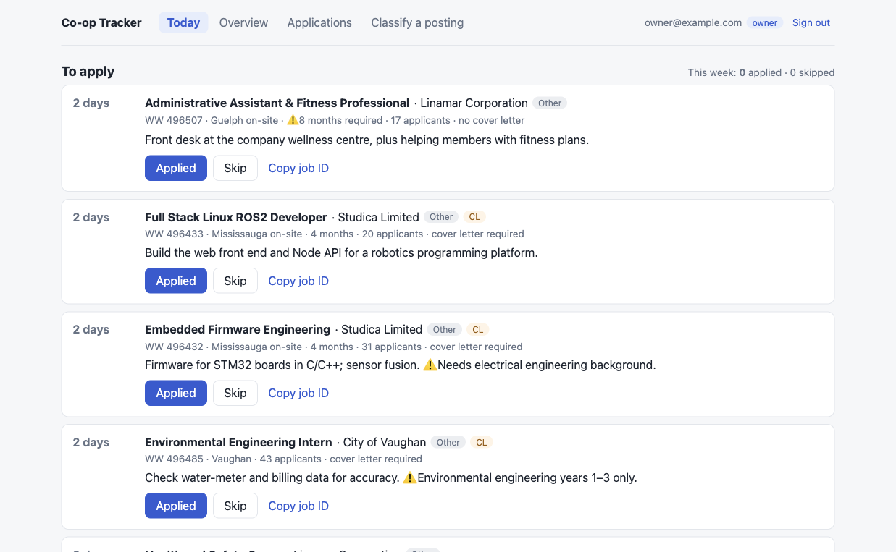
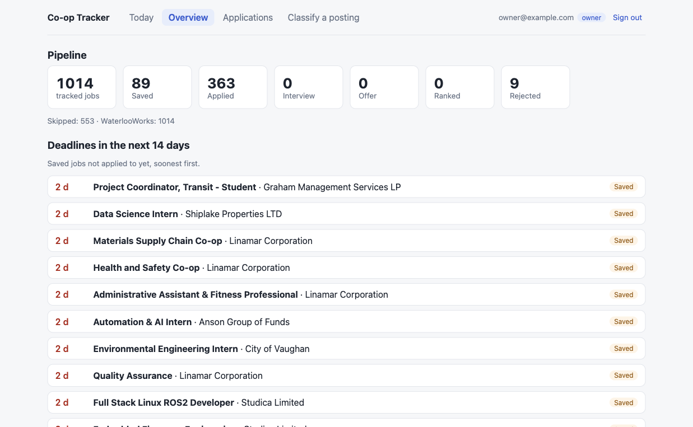
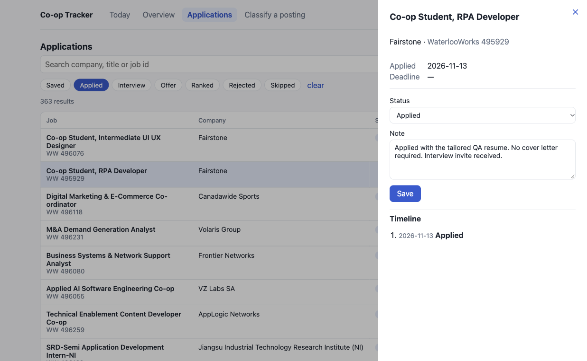
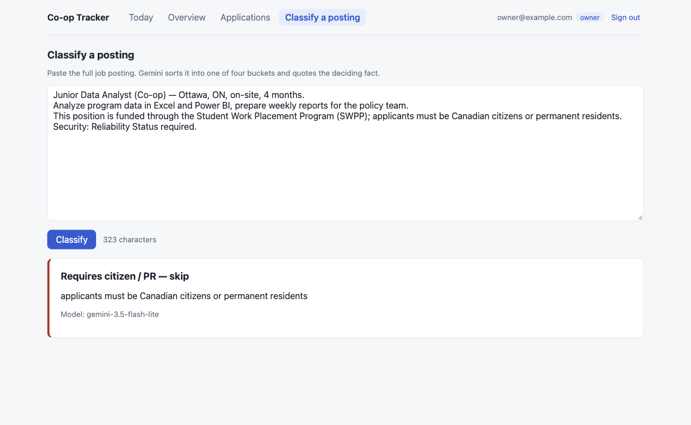

# Co-op Tracker

A full-stack web app I use every day during my co-op job search. An AI agent sorts new
WaterlooWorks postings and records my applications in a JSON file; this site turns that file into a
daily to-do queue, keeps it in sync both ways, lets a mentor follow along read-only, and classifies
pasted postings with an LLM.

**Live:** https://coop-tracker-phw6.onrender.com (sign-in required; on the free plan the first visit after a quiet period takes about 50 s to wake up)



<sub>Screenshots are from the live site; my email, notes and the Chinese one-line briefs the agent writes for me were swapped for sample text before capture.</sub>

## What it does

- **Today queue.** Sorted, still-open postings, most urgent deadline first, with location, term
  length, applicant count, cover-letter flag and a one-line brief. One click marks a job
  **Applied** or **Skipped** (with a reason); the header counts this week's progress.
- **Two-way sync with the agent.** `npm run sync` pulls my website clicks back into
  `applications.json`, then pushes the file to the API. Conflicts resolve by *last writer wins*.
- **Applications.** About 1,000 real records: search, status and source filters, pagination,
  a status timeline per job.
- **Roles.** The owner can edit; a viewer (e.g. a mentor) can only read. The sync agent uses a
  separate API token that can only sync.
- **LLM classifier.** Paste a posting, and Gemini sorts it into *citizen/PR-only*, *portfolio/design*,
  *Waterloo region* or *other*, quoting the deciding fact. Evaluated on **141**
  labelled real postings with a held-out test split: 68/70 on test, **0/23** citizen/PR postings missed,
  70/70 consistent across two runs ([reports](eval/gold/), [how](docs/BUILD_STORY.md)).

- **Tailor resume (RAG, owner-only).** Paste a posting; it retrieves my most relevant resume bullets and
  cover-letter paragraphs by embedding similarity, and Gemini picks which to use, citing each one.
  The page shows my original text, never model-written claims; a guard drops picks that cite an
  unretrieved excerpt or invent a number. Eval on 8 labelled postings: hit rate@8 8/8, recall@8 70.1%,
  0/35 picks blocked ([results](eval/rag/)). My private notes stay in the database, not in this repo.

There is no WaterlooWorks scraping. Data comes only from the agent's file.

| Overview | Applications + timeline | LLM classifier |
|---|---|---|
|  |  |  |

## Stack

| Layer | Tech |
|---|---|
| Frontend | React 19 + TypeScript, Vite |
| API | Node 22, Express 5, TypeScript, zod validation |
| Database | PostgreSQL (Neon in production; PGlite, Postgres compiled to WebAssembly, for dev/tests) |
| Auth | scrypt password hashes, server-side sessions (hashed tokens, HttpOnly cookies), CSRF header check, login rate limit, hashed API tokens |
| LLM | Google Gemini (`@google/genai`), structured JSON output, behind an interface with a fake for tests |
| Tests | Vitest + supertest (API/unit), Playwright (browser), GitHub Actions with a real PostgreSQL service |
| Hosting | Render (web service) + Neon (database) |

## Architecture

```
AI agent ── updates ──> applications.json ──npm run sync──> POST /api/sync ──> PostgreSQL
                              ^                                                    │
                              └──── GET /api/sync/pending (website edits) <────────┤
Browser (owner / viewer) <──── React app + REST API (Express, same origin) <───────┘
```

## REST API

| Method | Path | Who |
|---|---|---|
| POST | `/api/auth/login`, `/api/auth/logout`; GET `/api/auth/me` | anyone / signed in |
| GET | `/api/applications?status=&source=&q=&sort=&limit=&offset=` | owner, viewer |
| GET | `/api/applications/today`, `/api/applications/deadlines?days=` | owner, viewer |
| GET | `/api/applications/:id` (with timeline) | owner, viewer |
| PATCH | `/api/applications/:id` (status, note, dates) | owner |
| GET | `/api/stats` | owner, viewer |
| POST | `/api/classify`, `/api/rag/suggest`; GET `/api/rag/stats` | owner |
| POST | `/api/sync`, `/api/rag/chunks`; GET `/api/sync/pending` | sync agent (Bearer token) |

## Run locally

```bash
npm install
cp .env.example .env           # optional: GEMINI_API_KEY
npm run dev:seed               # local database from applications.json + two test accounts (.dev-credentials.json)
npm run build && npm start     # http://localhost:3000
```

Tests:

```bash
npm test            # Vitest: API, auth, sync, classifier (fake LLM)
npm run test:e2e    # Playwright: login, roles, Today queue, classify
```

## Design notes

Every real decision, bug and fix is written up in [docs/BUILD_STORY.md](docs/BUILD_STORY.md).
Some examples: why sessions instead of JWTs, why the database stores only token hashes, how two-way
sync decides who wins, and how a time zone bug showed up three separate times.
